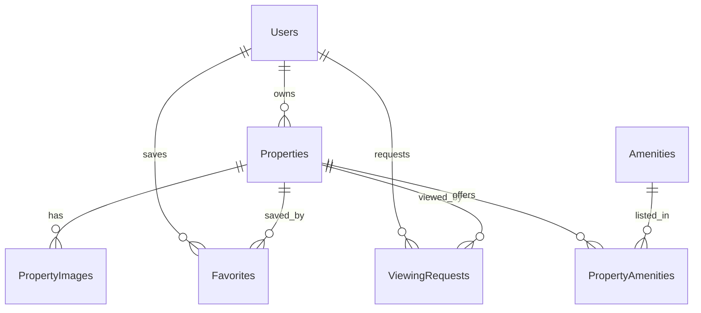

# CTU Stay — kiến trúc và phạm vi

## Use cases
- Khách: tìm phòng đang Active, lọc, phân trang, xem chi tiết, đăng ký và đăng nhập.
- Sinh viên: cập nhật hồ sơ, lưu phòng, đặt hoặc hủy lịch xem và theo dõi trạng thái.
- Chủ trọ: tạo/sửa tin, quản lý ảnh, đánh dấu đã thuê, xử lý lịch xem và xem dashboard.
- Quản trị: duyệt/từ chối tin, khóa/mở tài khoản, quản lý tiện ích và xem dashboard.

## Luồng dữ liệu
React/TypeScript → Axios/TanStack Query → ASP.NET Core controllers → services → EF Core → SQL Server. JWT định danh người dùng; API kiểm tra vai trò và quyền sở hữu. Ảnh được tải qua API sau xác thực lên Cloudinary; chỉ URL và public ID được lưu. Thời gian lưu UTC và hiển thị UTC+7.

## ERD

Users.Email duy nhất. Favorites(UserId, PropertyId) và PropertyAmenities(PropertyId, AmenityId) là khóa ghép. Price, Area phải dương. Properties có chỉ mục Status, District, Price, Area và CreatedAt. Xóa quan hệ dùng Restrict để tránh xóa lịch sử ngoài ý muốn.

## Quy tắc
Tin mới ở Pending. Admin duyệt thành Active hoặc Rejected. Chỉ Active được xem công khai và đặt lịch. Sửa nội dung tin chuyển về Pending. Active chuyển Rented khi chủ trọ đánh dấu đã thuê. Lọc nhiều tiện ích dùng điều kiện `All` (phải có mọi tiện ích được chọn). Ngày xem ở tương lai; tenant chỉ hủy lịch của mình, chủ trọ chỉ xử lý lịch của phòng mình.

## REST API
- Auth: `POST /api/auth/register`, `POST /api/auth/login`, `GET /api/auth/me`.
- Phòng: `GET/POST /api/properties`, `GET/PUT /api/properties/{id}`, `PATCH /api/properties/{id}/mark-rented`, `GET /api/landlord/properties`.
- Ảnh: `POST /api/properties/{id}/images`, `DELETE /api/properties/{id}/images/{imageId}`.
- Tiện ích: `GET /api/amenities`.
- Yêu thích: `GET /api/favorites`, `POST/DELETE /api/favorites/{propertyId}`.
- Lịch xem: `POST /api/viewing-requests`, `GET /api/viewing-requests/my`, `PATCH /api/viewing-requests/{id}/cancel`, `GET /api/landlord/viewing-requests`, `PATCH /api/landlord/viewing-requests/{id}/approve|reject`.
- Admin: `GET /api/admin/dashboard`, `GET /api/admin/properties/pending`, `PATCH /api/admin/properties/{id}/approve|reject`, `GET /api/admin/users`, `PATCH /api/admin/users/{id}/lock|unlock`, `POST/PUT/DELETE /api/admin/amenities/{id}`.

## Giao diện
Trang chủ có hero, thanh tìm kiếm, phòng nổi bật/mới và khu vực Cần Thơ. Trang danh sách có bộ lọc, sắp xếp, phân trang và các trạng thái tải/rỗng/lỗi. Chi tiết phòng có gallery và đặt lịch. Các khu Tenant, Landlord, Admin dùng layout riêng và menu theo vai trò. Mobile dùng menu gọn, thẻ phòng một cột; desktop hiển thị lưới và sidebar lọc. Màu chủ đạo #2563EB, nền #F8FAFC, font Be Vietnam Pro.

## Các giai đoạn
1. Kiến trúc, use case, ERD, API, UI: tài liệu này; kiểm tra bằng review.
2. Database: entities, DbContext, migrations, seed; kiểm tra `dotnet ef database update` trên SQL Server.
3. Auth: JWT, BCrypt, roles; kiểm tra đăng ký/đăng nhập và quyền.
4. CRUD, upload, duyệt tin; kiểm tra vòng đời tin.
5. Lọc, yêu thích, lịch xem; kiểm tra query và ownership.
6. Frontend: các trang và luồng API; kiểm tra build và responsive.
7. Tích hợp: chạy hai ứng dụng, smoke test và sửa lỗi.
8. README, API docs và hướng dẫn demo; kiểm tra lệnh chạy từ đầu.
